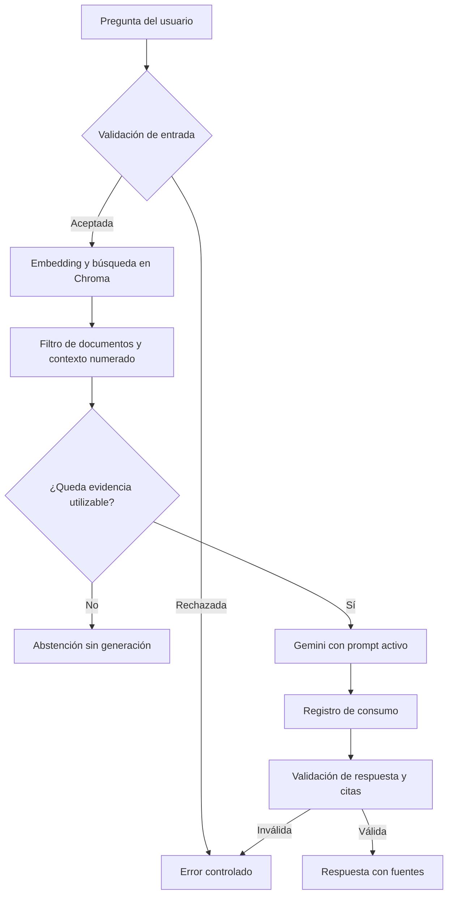
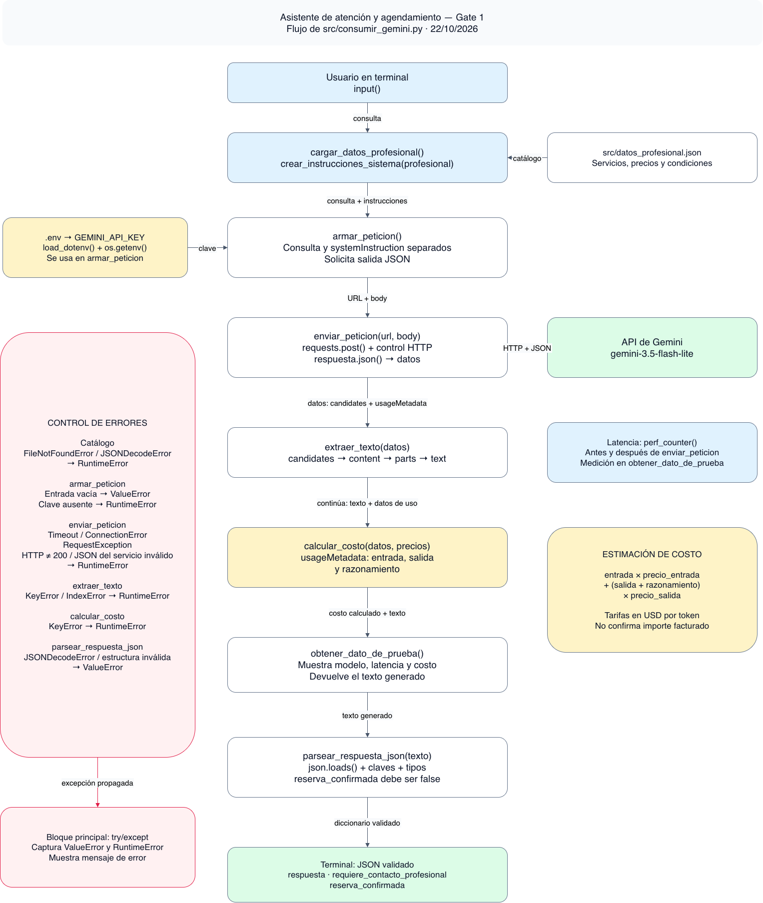

# Arquitectura del asistente para profesionales independientes

Estado documentado: 25 de noviembre de 2026.

## Objetivo

Orientar consultas sobre servicios y políticas de un profesional
independiente, utilizando información verificable y fuentes citadas.

La fotografía es el caso de demostración. No limita el producto
a profesionales de esa especialidad.

## Arquitectura actual — Gate 2

La entrada instrumentada es `registro_rag.py`. Recupera documentos,
filtra el contexto, genera una respuesta y registra tiempos y consumo.

Los eventos de la ruta instrumentada comparten un `trace_id`.
Si falla la validación de la respuesta, se conserva el consumo
reportado por el modelo y se registra el fallo.

La ausencia de fragmentos utilizables permite abstenerse sin generar.
Si existen fragmentos pero no responden la pregunta, las instrucciones
piden al modelo declarar que no dispone de información suficiente.

## Componentes principales

| Archivo | Responsabilidad |
|---|---|
| `indexar_corpus.py` | Crear, verificar y actualizar el índice persistente. |
| `recuperar_corpus.py` | Buscar fragmentos y construir el contexto con su mapa de citas. |
| `seguridad_rag.py` | Revisar preguntas y filtrar documentos mediante patrones sospechosos. |
| `responder_corpus.py` | Generar respuestas documentales y validar sus citas. |
| `registro_rag.py` | Instrumentar el RAG con tiempos, consumo y eventos correlacionados. |
| `logging_rag.py` | Proporcionar logs JSON y contexto de trazabilidad. |
| `registro_prompts.py` | Registrar versiones de prompts y sus huellas. |
| `grafo_supervision.py` | Pausar el flujo para aprobar o rechazar una propuesta de prompt. |
| `prompt_activo.py` | Aplicar la decisión y cargar la versión seleccionada. |
| `agente_con_herramientas.py` | Ofrecer herramientas del catálogo y memoria de conversación. |

## Documentos e índice

El corpus de demostración contiene cinco documentos en `docs/corpus/`:
dos servicios y tres documentos sobre agendamiento, cancelaciones y pagos.

El índice Chroma se guarda localmente en `vectorstore/`, excluido de Git.
En una instalación nueva debe construirse siguiendo el README.

La verificación permite reabrir el índice sin recalcular los embeddings
del corpus. La actualización conserva los fragmentos sin cambios y
procesa los nuevos o modificados.

## Seguridad y límites

- La pregunta se revisa antes de recuperar documentos.
- Los documentos sospechosos se excluyen antes de construir el contexto.
- Las reglas del sistema se mantienen separadas de la pregunta.
- Las citas deben corresponder al contexto aceptado.
- La existencia de una cita no demuestra por sí sola que respalde
  semánticamente toda la afirmación.
- Los patrones de detección son una defensa básica: no garantizan
  bloquear todos los ataques.
- La aplicación no consulta disponibilidad ni registra, envía,
  modifica, cancela o confirma reservas.

Los logs operativos evitan copiar preguntas, documentos o mensajes
completos de error. Los registros de evaluación pueden contener
preguntas y respuestas del caso simulado y deben revisarse antes
de publicarlos.

## Versionado y supervisión

LangGraph permite revisar una propuesta de prompt mediante una pausa
y una decisión humana. La versión aprobada se utiliza en las consultas
posteriores del RAG.

El punto de control del grafo utiliza memoria del proceso.
La selección activa se conserva localmente mediante `prompt_activo.py`.
No se ha implementado un sistema de usuarios, roles o aprobaciones remotas.

## Agente con memoria

El agente utiliza herramientas para consultar el catálogo JSON
y conserva el historial durante la sesión.

Actualmente funciona por separado del RAG documental.
Integrarlo mediante una herramienta de consulta documental es una
mejora opcional pendiente; no se presenta como funcionalidad terminada.

## Observabilidad y evaluación

Se registran tiempos por etapa, tokens informados por el proveedor
y costo estimado de generación.

El costo del embedding se declara desconocido cuando no se dispone
de información suficiente; no se considera gratuito automáticamente.

El banco de recuperación contiene diez consultas:
nueve con fuentes esperadas y una sobre información ausente.

Las 35 pruebas seleccionadas de seguridad, integración, supervisión,
prompt activo y consumo pasaron el 25 de noviembre de 2026.
Estas pruebas utilizan simulaciones y no sustituyen el ensayo real.

El ensayo desde un clon limpio verificó instalación, indexación,
persistencia, actualización, aprobación del prompt y una consulta
real con respuesta citada y trazabilidad.

- [Ensayo limpio de Gate 2](verificacion-instalacion-gate2.md)
- [Matriz de riesgos](matriz-riesgos.md)
- [Decisión de personalización](../decision_personalizacion.md)

## Antecedente — Gate 1

La primera versión utilizaba el catálogo JSON, llamadas HTTP a Gemini
y validación de una respuesta JSON con tres campos.

Ese contrato corresponde a la versión inicial. La salida documental
del RAG contiene texto y fuentes; no se confunde con aquel contrato.

[Diagrama editable de Gate 1](diagrama_arquitectura.drawio)

[Decisión inicial de modelo](decision-arquitectura.md)