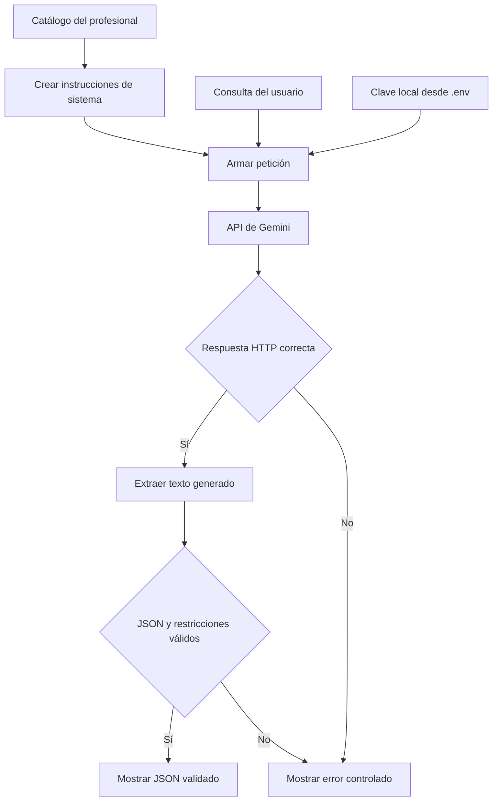

# Arquitectura del asistente de agendamiento

## Objetivo

Orientar consultas sobre servicios, precios y condiciones de un
profesional independiente mediante una aplicación de terminal
conectada a Gemini.

## Diagrama

## Componentes

| Componente | Responsabilidad |
|---|---|
| Terminal | Recibir la consulta y mostrar el resultado o un error. |
| `datos_profesional.json` | Contener servicios, precios, duración y condiciones. |
| `crear_instrucciones_sistema` | Preparar las reglas y el catálogo para el prompt de sistema. |
| `armar_peticion` | Separar `systemInstruction` del mensaje del usuario y solicitar salida JSON cuando se proporcionan instrucciones de sistema. |
| `enviar_peticion` | Enviar la petición con tiempo de espera, controlar errores HTTP y leer el JSON del servicio. |
| `extraer_texto` | Obtener el texto generado dentro de la respuesta del servicio. |
| `parsear_respuesta_json` | Interpretar el texto generado como JSON y validar su estructura y restricciones. |
| `calcular_costo` | Estimar el costo a partir del uso de tokens y las tarifas configuradas. |
| `perf_counter` | Medir la duración de la petición. |
| `.env` | Almacenar localmente la clave, excluida del repositorio. |

## Flujo de ejecución

1. Cargar el catálogo del profesional.
2. Crear las instrucciones de sistema con las reglas y el catálogo.
3. Recibir la consulta por terminal.
4. Construir la petición con instrucciones y consulta separadas.
5. Enviar la petición a Gemini y medir su duración.
6. Comprobar la respuesta HTTP y leer el JSON del servicio.
7. Extraer el texto generado y calcular el costo estimado.
8. Interpretar ese texto como JSON y validar sus claves, tipos
   y la restricción de no confirmar reservas.
9. Mostrar el JSON validado o un error controlado.

La latencia y el costo se imprimen antes de la validación final
del JSON generado. Por sí solos no demuestran que la salida
cumpla los requisitos.

## Dos niveles de JSON

- El JSON del servicio contiene la respuesta de Gemini y sus
  metadatos de uso.
- El JSON generado por el modelo contiene los datos de orientación
  que valida la aplicación.

Leer correctamente el primero no garantiza que el segundo sea válido.

## Estructura de la respuesta generada

| Clave | Tipo | Restricción |
|---|---|---|
| `respuesta` | Texto | No puede estar vacío. |
| `requiere_contacto_profesional` | Booleano | Indica si se necesita gestión directa del profesional. |
| `reserva_confirmada` | Booleano | Debe ser `false`. |

La validación de estructura no garantiza la exactitud de todo
el texto. Esa calidad también se revisa en las pruebas.

## Alcance actual

- Responde consultas usando el catálogo de ejemplo.
- No consulta disponibilidad real.
- No confirma reservas.
- No registra, guarda ni envía solicitudes al profesional.
- Orienta al contacto directo para concretar una reserva.
- Muestra costos estimados, no importes de facturación comprobados.

## Evaluación y pruebas

### Comparación de modelos

`src/evaluar_modelos.py` compara candidatos y conserva resultados
en `docs/evaluaciones/`.

Los registros existentes corresponden a las instrucciones utilizadas
en cada corrida. El script conserva el uso de `preparar_consulta`,
que combina instrucciones y consulta en un texto.

### Banco de prompts

`prompts/banco.py` define tres casos con instrucciones de sistema,
entradas y criterios esperados.

`prompts/test_consistencia.py` utiliza las instrucciones separadas,
ejecuta llamadas reales y registra éxitos y fallos en archivos
`prompts/registro-*.json`.

### Instalación limpia

El procedimiento y sus resultados están en
[Verificación de instalación](verificacion-instalacion.md).

## Decisión de modelo

La elección del modelo y sus limitaciones están documentadas en
[Decisión de arquitectura](decision-arquitectura.md).