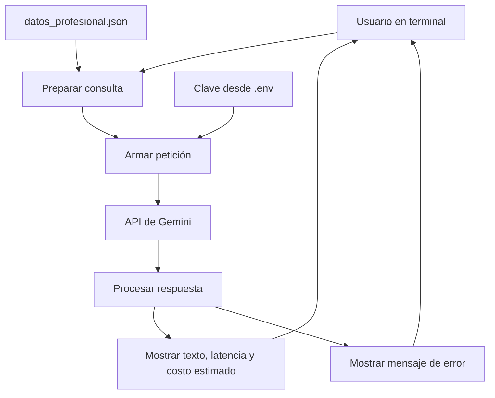

# Arquitectura del asistente de agendamiento

## Objetivo

Orientar consultas sobre servicios, precios y condiciones de un
profesional independiente mediante una aplicación de terminal conectada
a Gemini.

## Diagrama

## Componentes

| Componente | Responsabilidad |
|---|---|
| Terminal | Recibir la consulta y mostrar el resultado. |
| `datos_profesional.json` | Contener servicios, precios, duración y condiciones del profesional. |
| `preparar_consulta` | Combinar las instrucciones, los datos del profesional y la consulta. |
| `armar_peticion` | Construir la URL y el cuerpo de la petición para el modelo seleccionado. |
| `enviar_peticion` | Enviar la petición al servicio y leer su respuesta como JSON. |
| `extraer_texto` | Obtener el texto generado por el modelo. |
| `calcular_costo` | Estimar el costo usando los tokens informados y las tarifas configuradas. |
| `perf_counter` | Medir la duración de la petición. |
| `.env` | Almacenar localmente la clave; está excluido del repositorio. |

## Alcance actual

- Responde consultas sobre los datos incluidos en el catálogo.
- No consulta disponibilidad real.
- No confirma reservas.
- No registra ni envía solicitudes al profesional.
- El costo mostrado es una estimación, no una comprobación de facturación.

## Evaluación de modelos

El script `src/evaluar_modelos.py` reutiliza las funciones del cliente
para comparar candidatos con la misma consulta y cuatro intentos por
modelo.

Guarda respuestas, tiempos, uso de tokens, costos estimados y fallos en
`docs/evaluaciones/`. La revisión de calidad de las respuestas es manual.

## Estado de la arquitectura

Este diagrama representa la implementación actual. Se actualizará al
separar el prompt de sistema y agregar la validación de la salida JSON
generada por el modelo.